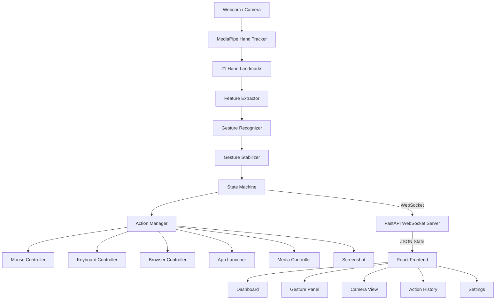

# ✦ AIRCONTROL
### AI-Powered Vision-Based Gesture-Controlled Computer Interface **+ AirSketch3D**

> Control your computer with hand gestures — and draw shapes in the air that turn into rotatable 3D models.

---

## Overview

AIRCONTROL is a computer-vision-based human-computer interaction system that transforms your webcam into a futuristic gesture-controlled interface. Using MediaPipe's hand landmark detection and a custom gesture recognition engine, AIRCONTROL lets you control your cursor, click, scroll, launch applications, control media, and more — all through intuitive hand gestures.

```
WEBCAM
   ↓
MEDIAPIPE HAND TRACKING (21 landmarks)
   ↓
FEATURE EXTRACTION (distances, angles, finger states)
   ↓
RULE-BASED GESTURE RECOGNITION
   ↓
TEMPORAL STABILIZATION (frame history + state machine)
   ↓
ACTION MANAGER
   ↓
COMPUTER / BROWSER / APPLICATION

SKETCH mode:  fingertip path → SketchEngine (draw / erase / pause / fist-hold)
              → resample + smooth + extrude → 3D model → WebSocket → three.js viewer (STL / OBJ export)
```

### Integrated Sketch 3D mode

AIRCONTROL's Sketch mode now contains the AirSketch3D drawing and inspection pipeline directly inside the existing
backend/frontend architecture. The desktop gesture system is unchanged; **pinch remains available for normal desktop
click/drag**, but Sketch mode deliberately has no pinch command.

| Gesture (Sketch mode) | Action |
|-----------------------|--------|
| ☝️ 1 finger | **Draw** |
| ✌️ 2 fingers | **Erase** |
| 🖐️ Open palm | **Pause / lift pen** |
| ✊ Fist, hold ~0.7 s | **Build 3D** |
| 👈 Swipe left | **Enter 3D inspection** (after a model exists) |
| 👉 Swipe right | **Return to drawing** |
| 👎 Thumbs down | **Exit Sketch mode** |
| 🤟 ILY | **Screenshot** |

The drawing engine smooths fingertip motion, ignores tiny jitter, survives brief ambiguous frames, snaps a contour when
the fingertip returns to its start, validates each component independently, resamples/smooths the outlines and extrudes
multiple disconnected closed shapes as one model. Open fragments left by erasing do not invalidate another valid closed
component.

3D inspection is also integrated into the dashboard: one hand rotates the model; two hands pan, zoom and twist it; a
fist solidifies the preview; and the swipe-right transition returns to Sketch drawing. STL and OBJ export remain available
from the viewer.

Sketch mode uses a deterministic, pinch-free recognizer rather than the optional ML classifier. The old ML training tools
remain in `ml/` for experimentation and do not participate in the live Sketch command path.

---

## Features

### Core Capabilities
- 🖱️ **Cursor Control** — Index finger controls mouse with smoothing & jitter reduction
- 👆 **Click** — Pinch gesture (thumb + index) for left-click with state machine safety
- ✋ **Drag** — Pinch + move for window/file dragging
- 📜 **Scroll** — Vertical index finger movement for scrolling
- 👈👉 **Swipe Navigation** — Horizontal swipes for next/previous
- 📸 **Screenshot** — Dedicated gesture captures screen

### Mode System
| Mode | Activation | Capabilities |
|------|-----------|--------------|
| **DESKTOP** | Default | Cursor, click, drag, scroll, screenshot |
| **BROWSER** | PEACE gesture | Navigation, scrolling, website launcher |
| **APPS** | THUMBS UP | Application launcher |
| **MEDIA** | Gesture | Play/pause, next/prev, volume |
| **SKETCH** | Sidebar button | Draw / erase / pause in the air, fist = 3D model |

### Application Launcher
Gesture-triggered launcher with configurable app cards. Customizable via `config/applications.json`.

### Website Launcher
Quick-access panel for favorite websites. Configurable via `config/websites.json`.

### Futuristic UI
Dark, cyber/HUD-inspired React dashboard with:
- Real-time hand landmark visualization
- Gesture confidence meter
- State machine display
- Action history log
- Animated notifications

---

## Architecture



---

## Technology Stack

| Layer | Technology |
|-------|-----------|
| Computer Vision | Python, OpenCV, MediaPipe |
| Gesture Recognition | Rule-based classifier with temporal stabilization |
| System Control | PyAutoGUI, webbrowser, subprocess |
| Backend API | FastAPI + WebSocket (uvicorn) |
| Frontend | React 18 + TypeScript + Vite |
| Styling | Tailwind CSS + custom CSS |
| Animation | Framer Motion |
| State Management | Zustand |

---

## Gesture Reference

Recognition uses MediaPipe landmark geometry (hand-size-normalised finger states), a priority order
(Pinch > Screenshot > Thumbs up > Thumbs down > Fist > Open palm > Peace > Index > Swipe), temporal
debouncing, and an **UNKNOWN** state when confidence is too low. A discrete gesture fires **once** and
must be released before it can fire again (so a held pinch is one click).

| Gesture | Pose | Desktop | Browser | Launcher | Media |
|---------|------|---------|---------|----------|-------|
| ☝️ Index | index only | move cursor | move cursor | hover an app | – |
| 🤏 Pinch | thumb tip touches index tip | click / select (hold + move = drag) | click / select | **launch hovered app** | – |
| ✊ Fist | all fingers closed | left click | left click | – | pause |
| 🖐️ Open palm | all fingers out | resume (after pause) | – | – | play / resume |
| ✌️ Peace | index + middle | browser mode | – | – | – |
| 👍 Thumbs up | thumb up, 4 fingers folded | open launcher | – | – | volume up |
| 👎 Thumbs down | thumb down, 4 fingers folded | pause control | exit browser mode | close launcher | tap = volume down, **hold 1.5 s = exit media mode** |
| 🤟 ILY | thumb + index + pinky out, middle + ring folded | screenshot | screenshot | screenshot | screenshot |
| 👈 / 👉 Swipe | fast horizontal move (open palm / index) | prev / next track | back / forward | – | prev / next track |
| ↕️ Vertical motion | index finger up/down | scroll | scroll | – | – |

Media mode is entered from the **Media** button in the sidebar (no gesture is assigned to enter it).

---

## AirSketch3D integration map

```text
backend/sketch/
├── engine.py       drawing state, closure, erase, validation, model payload
├── geometry.py     multi-component resampling, smoothing, triangulation
├── recognition.py  Sketch-only gesture logic; no pinch command
└── inspector.py    one/two-hand 3D inspection state

frontend/src/components/sketch/SketchViewer.tsx
                    └── live Three.js model, hand transforms, STL/OBJ export
```

The existing AIRCONTROL desktop/browser/media/app-launcher paths remain separate from this subsystem.

## Installation

### Prerequisites

- Python 3.10 or higher
- Node.js 18 or higher
- npm or yarn
- Webcam

> **macOS:** use `./start.sh` (see "Running"). Allow your Terminal in *System Settings → Privacy & Security* for
> **Camera**, **Accessibility** (mouse control) and **Screen Recording** (screenshots). Python **3.12** is recommended
> (MediaPipe 0.10.x does not support 3.13+; with MediaPipe 1.x the hand model file in `models/` is needed - see `models/README.md`).

### 1. Clone / Setup Project

```bash
cd aircontrol
```

### 2. Install Python Backend

```bash
python -m venv backend\venv

# Windows
backend\venv\Scripts\activate

# macOS/Linux
source backend/venv/bin/activate

pip install -r backend/requirements.txt
```

### 3. Install Frontend

```bash
cd frontend
npm install
```

---

## Running

### macOS / Linux

```bash
chmod +x start.sh start_backend.sh start_frontend.sh   # first time only
./start.sh            # backend + frontend + opens http://127.0.0.1:5173
```
(`./start_backend.sh` / `./start_frontend.sh` start them separately.)

### Everything at once on Windows (recommended)

Double-click **`start.bat`**. It starts the backend (creating the venv and installing requirements if needed),
waits until `http://127.0.0.1:8000/health` answers, starts the frontend, and opens `http://127.0.0.1:5173`.

### Backend only

Double-click **`start_backend.bat`** - it creates/repairs `backend\venv`, installs missing packages, and runs
`python -m uvicorn backend.main:app --host 127.0.0.1 --port 8000`. You never have to type that yourself.
(`python -m backend.main` also starts the server on the same address.)

### Frontend only

Double-click **`start_frontend.bat`** (runs `npm install` on first use, then Vite on `http://127.0.0.1:5173`).

API: `http://127.0.0.1:8000` - WebSocket: `ws://127.0.0.1:8000/ws`. The frontend reads these from
`frontend/src/config.ts` (override with `VITE_API_BASE` / `VITE_WS_URL`).

---

## Configuration

All configuration files are in the `config/` directory:

### `config/settings.json`
Main application settings (gesture thresholds, cursor sensitivity, camera settings).

### `config/applications.json`
Configure which apps appear in the launcher:
```json
{
  "applications": [
    {
      "name": "Chrome",
      "path": "C:\\Program Files\\Google\\Chrome\\Application\\chrome.exe",
      "icon": "chrome",
      "gesture": null
    }
  ]
}
```

### `config/websites.json`
Configure websites for the web launcher:
```json
{
  "websites": [
    {
      "name": "Google",
      "url": "https://www.google.com",
      "icon": "google",
      "gesture": "peace"
    }
  ]
}
```

### `config/gestures.json`
Gesture definitions and descriptions.

---

## Gesture Sensitivity Tuning

If gestures feel unreliable, adjust these in Settings:

| Setting | Default | Effect |
|---------|---------|--------|
| Confidence Threshold | 0.85 | Higher = less false triggers |
| Stabilization Frames | 8 | Higher = more stable, slower |
| Cooldown (ms) | 800 | Higher = more time between actions |
| Cursor Smoothing | 0.7 | Higher = smoother, less responsive |

---

## Training the ML gesture classifier (optional, Sketch mode)

Run these from the project root inside the backend venv (`source backend/venv/bin/activate`). **Stop the backend first** -
only one program can use the webcam.

```bash
pip install -r backend/requirements-ml.txt

# 1) every teammate records data (press a key to start/stop a label)
python -m ml.collect_gestures --person nilesh
#    d = DRAW (index only)  e = ERASE (index+middle)  p = PAUSE (open palm)  f = FIST  n = OTHER  q = quit
#    -> 500+ samples per label, vary distance / angle / lighting; merge teammates' CSV rows into ml/data/gesture_data.csv

# 2) train SVM + MLP, print accuracy / weighted F1 / confusion matrix, save the better one
python -m ml.train_gesture
python -m ml.train_gesture --holdout-person asha      # honest test on a teammate the model never saw

# 3) restart the backend: "Loaded ML gesture model for Sketch mode." appears in the log
```
Confusion-matrix images are written to `ml/reports/`. Labels must be exactly `DRAW, ERASE, PAUSE, FIST, OTHER`
(an old model with `OPEN` labels is ignored and the rules are used instead).

**Fixing a CSV without a header** (`KeyError: 'label'`): the first line must be `label,person,f0,...,f62`.
```python
import pandas as pd
cols = ["label", "person"] + [f"f{i}" for i in range(63)]
pd.read_csv("ml/data/gesture_data.csv", header=None, names=cols).to_csv("ml/data/gesture_data.csv", index=False)
```
(run it with `python -c` or save it as a small script.) If you recorded earlier with the old `OPEN` label, rename it:
`df["label"] = df["label"].replace({"OPEN": "PAUSE"})`.

## AirSketch3D without the web UI

```bash
python -m standalone.airsketch3d      # OpenCV window; hold a fist -> matplotlib 3D window (drag to rotate)
```

---

## Testing

```bash
# From the project root
backend\venv\Scripts\activate  # Windows

# Run all tests (69: recognizer, stabilizer, modes, API, sketch engine, end-to-end pipelines)
python -m pytest backend/tests -q

# Run specific test file
python -m pytest backend/tests/test_sketch.py -v
```

---

## Emergency Controls

| Key | Action |
|-----|--------|
| **ESC** | Emergency stop — disables all gesture control immediately |
| **Open Palm** gesture | Resume gesture control |
| **THUMBS DOWN** | Cancel current action / exit current mode |

The system status indicator always shows whether gestures are **ACTIVE** or **PAUSED**.

---

## Troubleshooting

### Camera not detected
- Check camera permissions in system settings
- Try changing `camera_index` in `config/settings.json` (try 0, 1, 2)
- Ensure no other app is using the webcam

### Gestures not recognized
- Ensure good lighting
- Keep hand within camera frame
- Try adjusting confidence threshold (lower = more sensitive)
- Make sure hand is clearly visible without obstructions

### High latency / low FPS
- Close other applications using the CPU
- Reduce camera resolution in settings
- Ensure Python environment has proper MediaPipe installation

### Python crashes with `DrishtiMetalHelper` / "Service is unavailable" (macOS)
MediaPipe 1.x tries to start the Mac GPU path and aborts. Use `mediapipe==0.10.14` on Python 3.12 (the pinned
`backend/requirements.txt`).

### `module 'mediapipe' has no attribute 'solutions'`
You have MediaPipe 1.x. Either install `mediapipe==0.10.14` (Python 3.12) or download `models/hand_landmarker.task`
(the tracker then switches to the Tasks API automatically).

### Sketch mode: strokes jitter or gestures flicker
Raise `gesture.stabilization_frames` in Settings, or train the ML classifier (more robust draw-vs-erase detection).

### Application won't launch
- Verify the application path in `config/applications.json`
- Check the path exists on your system
- Use full absolute paths

### Frontend won't connect
- Ensure backend is running first (`./start_backend.sh` or `python -m uvicorn backend.main:app`)
- Check firewall isn't blocking port 8000
- Look for errors in backend terminal

---

## Project Structure

```
aircontrol/
├── README.md
├── config/
│   ├── applications.json     # App launcher configuration
│   ├── websites.json         # Website launcher configuration
│   ├── gestures.json         # Gesture definitions
│   └── settings.json         # Main settings
├── backend/
│   ├── main.py               # FastAPI + WebSocket entry point
│   ├── requirements.txt      # Python dependencies
│   ├── config/               # Config management
│   ├── vision/               # Camera + MediaPipe
│   ├── gestures/             # Recognition + stabilization
│   ├── actions/              # System control
│   ├── modes/                # Mode management (DESKTOP / BROWSER / APPS / MEDIA / SKETCH)
│   ├── sketch/engine.py      # AirSketch3D: strokes, erase, fist-hold, outline -> 3D model
│   ├── gestures/ml_classifier.py  # optional SVM/MLP gesture classifier for Sketch mode
│   └── tests/                # Automated tests (69)
├── ml/                       # collect_gestures.py + train_gesture.py (+ data/, reports/)
├── models/                   # gesture_model.joblib (after training), hand_landmarker.task (MediaPipe 1.x only)
├── standalone/               # Backwards-compatible standalone demo; integrated app lives in backend/sketch/
└── frontend/
    ├── package.json
    ├── vite.config.ts
    ├── tailwind.config.js
    └── src/
        ├── components/       # React components (sketch/SketchViewer.tsx = three.js 3D viewer)
        ├── pages/            # Route pages
        ├── store/            # Zustand state
        ├── hooks/            # Custom hooks
        ├── api/              # Backend client
        └── types/            # TypeScript types
```

---

## Limitations

- Single hand tracking only (multi-hand support architecturally ready)
- Windows-optimized (paths, key shortcuts); macOS works (launcher uses `open -a`, browser nav uses ⌘[ / ⌘]); media keys are not supported by pyautogui on macOS
- Webcam required (virtual cameras may not work)
- Screenshot gesture saves to `~/Pictures/AIRCONTROL/`
- Some media keys may not work without active media player

---

## Future Improvements

- [ ] Multi-hand support for complex gestures
- [x] ML-based gesture classifier (Sketch mode, optional) - extend it to all modes
- [ ] Voice + gesture hybrid control
- [ ] macOS and Linux full support
- [ ] Custom gesture training UI
- [ ] Plugin system for third-party actions
- [ ] Multiple camera support
- [ ] Gesture recording and playback
- [ ] Accessibility mode with reduced motion

---

## License

MIT License — free for personal, educational, and portfolio use.

---

*Built with ❤️ using Python, MediaPipe, React, and a lot of hand-waving.*

```bash
pytest -q
```

## Safety
ESC immediately disables gesture actions. AIRCONTROL intentionally does not expose destructive filesystem or arbitrary shell operations through gestures.

## Notes
The browser UI receives real-time state through WebSocket and the camera feed through the backend MJPEG endpoint. The backend owns the webcam so MediaPipe and OS actions remain in one process.
